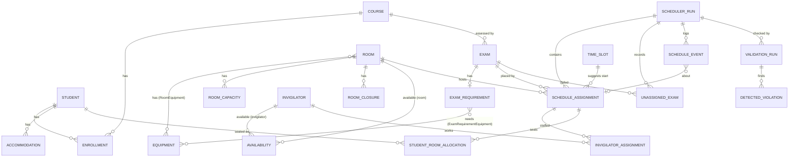

# ER Diagram, Relationships, IDs and Lifecycles

## 1. ER diagram (Mermaid)



## 2. Cardinality table

| Relationship | Cardinality | Optional? | Implemented by |
|---|---|---|---|
| Student - Course | N:M | yes | `Enrollment` (bridge) |
| Course - Exam | 1:N (one per term) | Exam must have a Course | FK `Exam.course` + unique(course, term) |
| Exam - ExamRequirement | 1:1 | Requirement optional | OneToOne `ExamRequirement.exam` |
| ExamRequirement - Equipment | N:M | yes | `ExamRequirementEquipment` |
| Room - Equipment | N:M | yes | `RoomEquipment` |
| Room - RoomCapacity | 1:N | at least one | FK `RoomCapacity.room` |
| Room - RoomClosure | 1:N | yes | FK `RoomClosure.room` |
| Room - Availability | 1:N | yes | nullable FK `Availability.room` |
| Invigilator - Availability | 1:N | yes | nullable FK `Availability.invigilator` |
| Student - Accommodation | 1:N | yes | FK `Accommodation.student` |
| Exam - Room | N:M | yes | `ScheduleAssignment` (bridge, one row per exam-room-run) |
| SchedulerRun - ScheduleAssignment | 1:N | no | FK `ScheduleAssignment.run` |
| ScheduleAssignment - Invigilator | N:M | at least 1 for a valid assignment | `InvigilatorAssignment` |
| ScheduleAssignment - Student | N:M | one row per enrolled student | `StudentRoomAllocation` |
| SchedulerRun - UnassignedExam | 1:N | yes | FK |
| ValidationRun - DetectedViolation | 1:N | yes | FK |

`Availability` has two nullable FKs (`room`, `invigilator`) and a database CHECK that **exactly one** is filled.

## 3. ID conventions

IDs are deterministic, zero-padded, immutable, generated by `apps/core/services/id_generator.py` (not in `save()`).

| Entity | Format | Regex |
|---|---|---|
| Student | `STU-000001` | `^STU-\d{6}$` |
| Course | `CRS-000001` | `^CRS-\d{6}$` |
| Enrollment | `ENR-000001` | `^ENR-\d{6}$` |
| Exam | `EXAM-2026-000001` | `^EXAM-\d{4}-\d{6}$` |
| ExamRequirement | `REQ-000001` | `^REQ-\d{6}$` |
| Room | `ROOM-000001` | `^ROOM-\d{6}$` |
| RoomCapacity | `CAP-000001` | `^CAP-\d{6}$` |
| RoomClosure | `CLS-000001` | `^CLS-\d{6}$` |
| Invigilator | `INV-000001` | `^INV-\d{6}$` |
| Availability | `AVL-000001` | `^AVL-\d{6}$` |
| Accommodation | `ACC-000001` | `^ACC-\d{6}$` |
| TimeSlot | `SLOT-000001` | `^SLOT-\d{6}$` |
| SchedulerRun | `RUN-000001` | `^RUN-\d{6}$` |
| ScheduleAssignment | `ASN-<exam-id>-<room-id>-<run-id>` e.g. `ASN-EXAM-2026-000001-ROOM-000001-RUN-000001` | `^ASN-EXAM-\d{4}-\d{6}-ROOM-\d{6}-RUN-\d{6}$` |
| InvigilatorAssignment | `IAS-000001` | `^IAS-\d{6}$` |
| StudentRoomAllocation | `SRA-000001` | `^SRA-\d{6}$` |
| UnassignedExam | `UNA-000001` | `^UNA-\d{6}$` |
| ScheduleEvent | `EVT-000001` | `^EVT-\d{6}$` |
| ValidationRun | `VAL-000001` | `^VAL-\d{6}$` |
| DetectedViolation | `VIO-000001` | `^VIO-\d{6}$` |
| Equipment | natural key, e.g. `PROJECTOR`, `COMPUTER`, `LAB_BENCH` | `^[A-Z_]+$` |

The run suffix is added to the required `ASN-<exam-id>-<room-id>` pattern so two runs can hold the same exam-room pair without an ID clash.

## 4. Lifecycle states

```
Exam:           DRAFT -> PLANNED -> SCHEDULED
                              \-> UNASSIGNED          (UNASSIGNED -> PLANNED on re-run)
Enrollment:     ACTIVE -> DROPPED | WITHDRAWN | COMPLETED
ScheduleAssignment: ASSIGNED -> SUPERSEDED | CANCELLED
SchedulerRun:   RUNNING -> COMPLETED | FAILED
ValidationRun:  RUNNING -> PASSED | FAILED_CHECKS | ERROR
Student:        ACTIVE <-> INACTIVE ; ACTIVE -> GRADUATED
Accommodation:  ACTIVE -> REVOKED   (expiry is by effective_to date, not status)
```

Invalid transitions (e.g. `CANCELLED -> ASSIGNED`) are rejected by a service-layer function. Old rows are never deleted.

## 5. Effective dates

| Entity | Fields | Rule |
|---|---|---|
| RoomCapacity | `effective_from`, `effective_to` (null = open-ended) | Ranges for one room must not overlap |
| Accommodation | `effective_from`, `effective_to` | Applies only if exam date falls inside |
| Enrollment | `effective_from`, `effective_to` | Active only inside the range and `status = ACTIVE` |
| RoomClosure | `start_at`, `end_at` | Blocks any overlapping interval |
| Availability | `start_at`, `end_at` | Allocation must be fully inside one window |